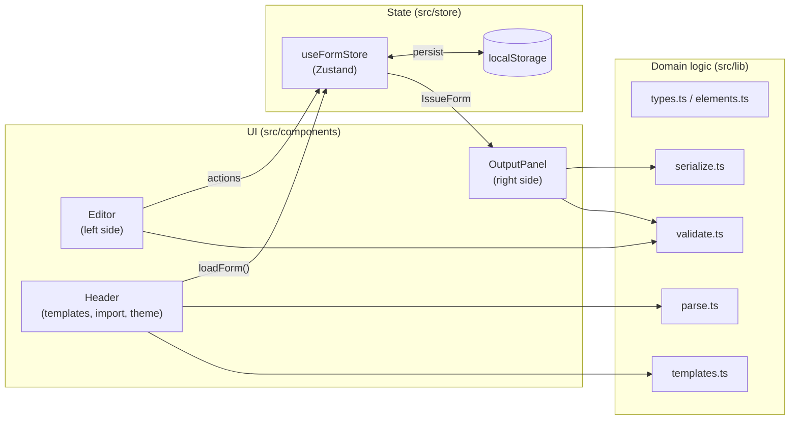

# Architecture

The Issue Form Generator is a single-page React application without a backend. It is built by Vite into static files
and hosted on GitHub Pages. All data stays in the user's browser.

## Layers



| Layer             | Folder                        | Depends on         | Notes                                                        |
| ----------------- | ----------------------------- | ------------------ | ------------------------------------------------------------ |
| Domain logic      | `src/lib`                     | `yaml` only        | Pure TypeScript, no React. Fully unit tested.                |
| State             | `src/store`                   | `src/lib`, Zustand | One store with the form and all mutations.                   |
| UI                | `src/components`              | everything above   | Mantine components. No business rules beyond input handling. |
| App shell / entry | `src/App.tsx`, `src/main.tsx` | UI                 | Providers and the responsive split layout.                   |

Keeping `src/lib` free of React makes the YAML logic easy to test and to reuse (e.g. for a CLI later).

## Folder structure

```
src/
├── lib/
│   ├── types.ts          # IssueForm, FormElement union, ELEMENT_TYPES
│   ├── elements.ts       # factories (createElement, duplicateElement), id/file name helpers, ELEMENT_INFO
│   ├── serialize.ts      # IssueForm → YAML
│   ├── parse.ts          # YAML → IssueForm (import)
│   ├── validate.ts       # schema checks → errors / warnings
│   ├── templates.ts      # starter templates
│   └── lib.test.ts       # unit tests
├── store/
│   ├── formStore.ts      # Zustand store with persistence
│   └── hooks.ts          # useIssueForm, useValidation, useIsFormEmpty
├── components/
│   ├── Header.tsx, ColorSchemeToggle.tsx, ImportModal.tsx, Markdown.tsx, elementIcons.ts
│   ├── editor/           # FormSettingsEditor, ElementList, ElementCard, TypePickerModal, ElementDialog, steps
│   └── output/           # OutputPanel, FormPreview, ValidationSummary
├── App.tsx               # split view (desktop) / tab switch (mobile)
├── main.tsx              # MantineProvider, ModalsProvider, Notifications, code highlighting
├── theme.ts              # Mantine theme
└── styles.css            # global styles, YAML token colors
```

## Data flow

1. The user edits something in the **Editor** (e.g. the form name or an element via the dialog).
2. The component calls a store action (`updateSettings`, `addElement`, `updateElement`, …).
3. Zustand notifies subscribers and the `persist` middleware writes the form to localStorage.
4. **OutputPanel** reads the form via `useIssueForm()` and memoizes `formToYaml(form)` and `validateForm(form)`.
5. The YAML is highlighted; validation issues are shown in `ValidationSummary` and on the element cards.

The element dialog works on a local **draft** copy. Changes reach the store only when the user clicks
_Add to form_ / _Save_, so cancelling never leaves half-configured elements behind. The dialog shows its own live
YAML snippet of the draft (`elementToYaml`).

## Key decisions

| Decision                                      | Reason                                                                                     |
| --------------------------------------------- | ------------------------------------------------------------------------------------------ |
| Own model instead of editing YAML AST         | Simple, typed forms; YAML is derived output. Unknown keys are reported on import.          |
| `uid` on every element                        | Stable React keys and drag & drop ids, independent of the user-editable `id`.              |
| Flat element fields (`required`, `minLength`) | Easier form binding than nested `attributes` / `validations`; mapping is in one place.     |
| Mantine                                       | Complete component set with built-in light/dark/auto color scheme, modals, notifications.  |
| Zustand + `persist`                           | Minimal boilerplate, auto-save for free.                                                   |
| `yaml` (eemeli/yaml)                          | Full YAML 1.2 support, fine control over output style (block literals, flow lists).        |
| `base: './'` in Vite                          | Build works on any GitHub Pages path without configuration.                                |
| Read-only YAML panel                          | Avoids sync conflicts with invalid YAML while typing; import covers the reverse direction. |
