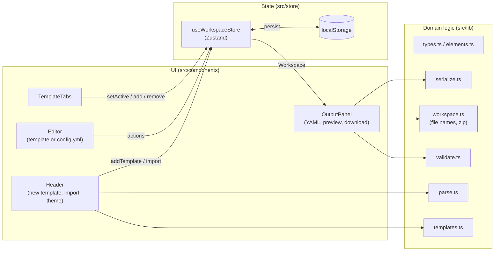

# Architecture

The Issue Form Generator is a single-page React application without a backend. It is built by Vite into static files
and hosted on GitHub Pages. All data stays in the user's browser.

The user works on a **workspace**: several issue form templates plus the template chooser configuration
(`config.yml`). Together they are the content of a repository's `.github/ISSUE_TEMPLATE/` folder.

## Layers



| Layer             | Folder                        | Depends on             | Notes                                                        |
| ----------------- | ----------------------------- | ---------------------- | ------------------------------------------------------------ |
| Domain logic      | `src/lib`                     | `yaml`, `jszip` (lazy) | Pure TypeScript, no React. Fully unit tested.                |
| State             | `src/store`                   | `src/lib`, Zustand     | One store with the workspace and all mutations.              |
| UI                | `src/components`              | everything above       | Mantine components. No business rules beyond input handling. |
| App shell / entry | `src/App.tsx`, `src/main.tsx` | UI                     | Providers and the responsive split layout.                   |

Keeping `src/lib` free of React makes the YAML logic easy to test and to reuse (e.g. for a CLI later).

## Folder structure

```
src/
├── lib/
│   ├── types.ts            # IssueForm, FormElement union, Template, ChooserConfig, Workspace
│   ├── elements.ts         # element factories, id/file name helpers, ELEMENT_INFO
│   ├── workspace.ts        # templates, file names, config defaults, file list, zip
│   ├── serialize.ts        # IssueForm → YAML, ChooserConfig → config.yml
│   ├── parse.ts            # YAML → IssueForm / ChooserConfig (import)
│   ├── validate.ts         # schema checks → errors / warnings
│   ├── templates.ts        # starter templates
│   └── *.test.ts           # unit tests
├── store/
│   ├── workspaceStore.ts   # Zustand store with persistence and migration
│   ├── hooks.ts            # useActiveTemplate, useWorkspace, useValidation, ...
│   └── *.test.ts
├── components/
│   ├── Header.tsx, NewTemplateMenu.tsx, ImportModal.tsx, ColorSchemeToggle.tsx, Markdown.tsx, ...
│   ├── editor/             # TemplateTabs, FormSettingsEditor, ElementList, ElementDialog, ConfigEditor, ...
│   └── output/             # OutputPanel, FormPreview, ChooserPreview, ValidationSummary
├── test/                   # test setup (browser API stubs) and render helper
├── App.tsx                 # split view (desktop) / tab switch (mobile)
├── main.tsx                # MantineProvider, ModalsProvider, Notifications, code highlighting
├── theme.ts                # Mantine theme
└── styles.css              # global styles, YAML token colors
```

## Data flow

1. The user picks a template tab (or `config.yml`) in **TemplateTabs** → `setActive(id)`.
2. Edits in the **Editor** call store actions. Template actions (`updateSettings`, `addElement`, …) always apply to
   the active template; `updateConfig` changes `config.yml`.
3. Zustand notifies subscribers and the `persist` middleware writes the workspace to localStorage.
4. **OutputPanel** shows the YAML of the active template or `config.yml` (memoized), the matching validation issues,
   and offers downloading the single file or all files as a zip.
5. `validateWorkspace` runs once per change for the whole workspace. Issues carry a `scope` (template uid or
   `config`), so the tabs can show error dots and the output panel shows only the issues of the open file.

The element dialog works on a local **draft** copy. Changes reach the store only when the user clicks
_Add to form_ / _Save_, so cancelling never leaves half-configured elements behind.

## Key decisions

| Decision                                       | Reason                                                                                     |
| ---------------------------------------------- | ------------------------------------------------------------------------------------------ |
| Own model instead of editing YAML AST          | Simple, typed forms; YAML is derived output. Unknown keys are reported on import.          |
| `uid` on templates, elements and contact links | Stable React keys and drag & drop ids, independent of user-editable ids and names.         |
| Actions operate on the active template         | Editor components stay unaware of multiple templates.                                      |
| File names derived from the name by default    | Works out of the box; a custom file name controls the order in GitHub's template chooser.  |
| `config.yml` only exported when not default    | GitHub's defaults need no file, so the zip contains only what is necessary.                |
| JSZip loaded on demand                         | Keeps ~30 kB (gzip) out of the initial bundle; only needed when downloading a zip.         |
| Mantine                                        | Complete component set with built-in light/dark/auto color scheme, modals, notifications.  |
| Zustand + `persist`                            | Minimal boilerplate, auto-save and versioned migrations for free.                          |
| `yaml` (eemeli/yaml)                           | Full YAML 1.2 support, fine control over output style (block literals, flow lists).        |
| `base: './'` in Vite                           | Build works on any GitHub Pages path without configuration.                                |
| Read-only YAML panel                           | Avoids sync conflicts with invalid YAML while typing; import covers the reverse direction. |
