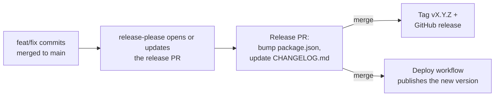

# Releasing & versioning

The project follows [Semantic Versioning 2.0.0](https://semver.org): `MAJOR.MINOR.PATCH`.

| Change                                                                     | Version bump |
| -------------------------------------------------------------------------- | ------------ |
| Incompatible change, e.g. saved forms or imports from older versions break | MAJOR        |
| New feature, e.g. a new element type or a `config.yml` editor              | MINOR        |
| Bug fix, runtime dependency update                                         | PATCH        |
| Docs, tests, refactoring, CI, dev dependencies                             | none         |

The current version is in `package.json`, shown in the app header and listed in [CHANGELOG.md](../CHANGELOG.md).

## Conventional Commits

Versions are derived automatically from commit messages in the
[Conventional Commits](https://www.conventionalcommits.org) format:

```
<type>(<optional scope>): <description>

[optional body]

[optional footer, e.g. BREAKING CHANGE: ...]
```

| Type                                                        | Release | Changelog section |
| ----------------------------------------------------------- | ------- | ----------------- |
| `feat`                                                      | minor   | Features          |
| `fix`                                                       | patch   | Bug Fixes         |
| `perf`                                                      | patch   | Performance       |
| `revert`                                                    | patch   | Reverts           |
| `docs`, `style`, `refactor`, `test`, `build`, `ci`, `chore` | none    | hidden            |
| any type with `!` (`feat!:`) or a `BREAKING CHANGE:` footer | major   |                   |

Examples:

```
feat: add editor for config.yml
fix(import): keep dropdown default of 0
feat!: store multiple templates per project

BREAKING CHANGE: saved data from 1.x is migrated to a list of templates.
```

Enforcement:

- **Locally**: husky runs commitlint on every commit (`.husky/commit-msg`, `commitlint.config.js`).
- **CI**: the `Conventional commits` job lints all commits of a pull request and the pull request title
  (the title becomes the commit message when squash-merging).
- **Dependabot** uses `fix(deps)` for runtime dependencies (patch release) and `chore(deps)` for dev dependencies.

## Release process (release-please)

[release-please](https://github.com/googleapis/release-please) runs on every push to `main`
(`.github/workflows/release.yml`):



1. Merge pull requests with conventional commit messages into `main`.
2. release-please keeps one pull request named like `chore(main): release 1.1.0` up to date.
3. When you want to release, merge that pull request. release-please then creates the tag `v1.1.0` and the
   GitHub release with the changelog; the Pages deployment runs for the same push.

Configuration:

| File                            | Purpose                                           |
| ------------------------------- | ------------------------------------------------- |
| `release-please-config.json`    | Release type `node`, changelog sections           |
| `.release-please-manifest.json` | Last released version (updated by release-please) |
| `CHANGELOG.md`                  | Generated changelog (1.0.0 was written by hand)   |

Never edit the version in `package.json` or the manifest by hand. To force a specific version, add
`Release-As: 2.0.0` as a footer to a commit.

## One-time repository settings

- **Settings → Actions → General → Workflow permissions**: enable
  _Allow GitHub Actions to create and approve pull requests_ (required for the release PR).
- Pull requests created by release-please with the default `GITHUB_TOKEN` do not trigger the CI workflow. That is
  fine because the release PR only changes `package.json`, the manifest and the changelog. If you want CI on it,
  give the workflow a fine-grained personal access token via the `token` input.

## First release

Version `1.0.0` is the initial release. After pushing `main`, push the tag and optionally create the GitHub release:

```bash
git push origin main --follow-tags
gh release create v1.0.0 --title "v1.0.0" --notes-file CHANGELOG.md   # optional
```
